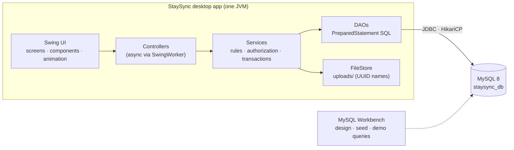
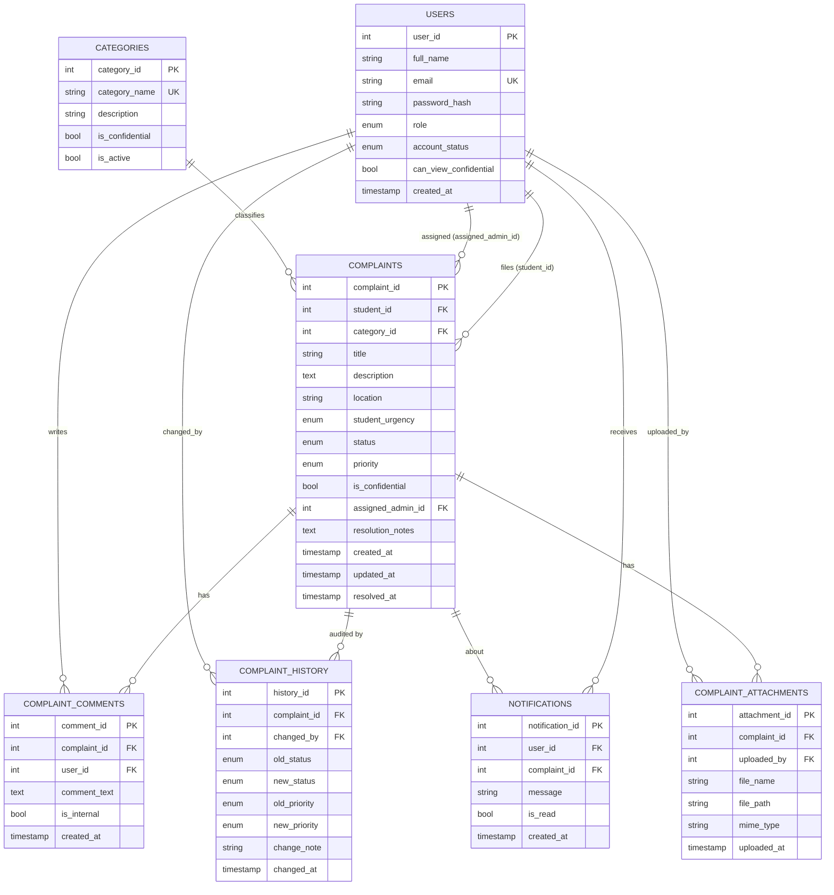
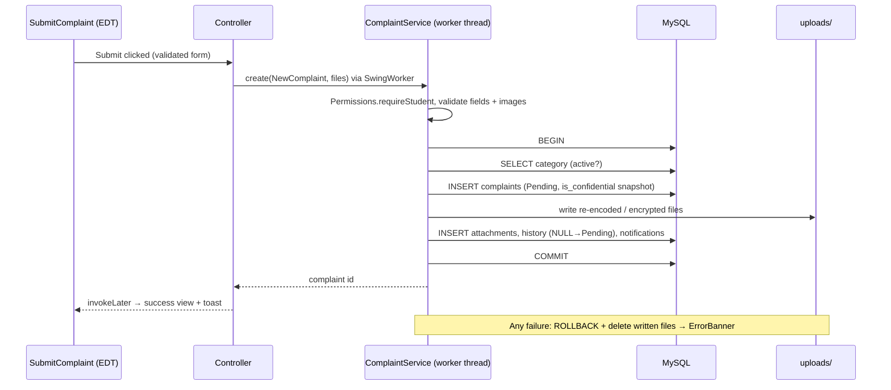

# StaySync — ARCHITECTURE.md (Java Swing Edition)

Companion to `PRD.md` (what) and `DESIGN.md` (how it looks). This document is **how it works**: stack, structure, threading, database, security, build and run.

> **Stack (fixed):** Java Swing GUI · Java application logic · JDBC · MySQL · MySQL Workbench. No React, JavaScript, HTML/CSS, REST backend, or web framework.
> Version numbers below mean "latest stable at project start". Pin them in `pom.xml` and verify third-party class names against the pinned versions.

---

## 1. System Overview



**Shape:** a layered two-tier desktop app. Swing renders; services enforce every rule; MySQL guarantees integrity. The UI is never trusted to make authorization decisions — it only reflects them.

**Trust model (read this):** in a two-tier desktop app every installed client can reach the database. For this prototype that is acceptable, with mitigations: a least-privilege DB account, credentials in an untracked config file (never in source), authorization in the service layer, a confidentiality **view** and a status-transition **trigger** as database-level backstops, and encrypted confidential attachments. The honest limitation — someone with the JAR *and* the config file can talk to MySQL directly — is documented in the report as *future scope: introduce a server tier*.

---

## 2. Tech Stack

| Concern | Choice | Why |
|---|---|---|
| Language / runtime | **Java 21 (LTS)** | Records, pattern matching, modern APIs |
| GUI | **Java Swing** | Required |
| Look & feel | **FlatLaf** (`flatlaf`, `flatlaf-extras`, `flatlaf-fonts-inter`, `flatlaf-fonts-jetbrains-mono`) | Modern, themeable (light/dark), HiDPI-aware, animation helpers |
| Layout | **MigLayout** (`miglayout-swing`) | Readable, resize-friendly layouts without `null` layouts |
| Icons | Lucide SVGs via `FlatSVGIcon` | Crisp at any scale, theme-tintable |
| Charts | Custom Java2D components (JFreeChart as fallback) | Full theme/animation control |
| DB access | **JDBC** (MySQL Connector/J) + **HikariCP** pool | Required JDBC; pool avoids reconnect lag |
| Database | **MySQL 8.x** (InnoDB, `utf8mb4`), developed in **MySQL Workbench** | Required; CHECK constraints need 8.0.16+ |
| Password hashing | `at.favre.lib:bcrypt` | Maintained BCrypt implementation |
| Logging | SLF4J + Logback (rolling file, no PII) | Standard |
| Build | **Maven**, `maven-shade-plugin` → runnable `staysync.jar`; optional `jpackage` installer | Simple, IDE-friendly |
| Tests | JUnit 5, AssertJ, Testcontainers MySQL (or local `staysync_test` schema) | Service/DAO coverage; confidentiality suite |
| Dev environment | Antigravity (AI-assisted), MySQL Workbench | Per brief |

Optional: LGoodDatePicker for date-range fields (theme it with tokens); otherwise two `JFormattedTextField`s with validation.

---

## 3. Repository Layout (Maven, single module)

```
staysync/
├── README.md  .cursorrules  pom.xml  .gitignore
├── docs/                       PRD.md  DESIGN.md  ARCHITECTURE.md  screenshots/
├── config/
│   └── app.properties.example  # committed; real app.properties is git-ignored
├── database/
│   ├── 01_schema.sql           # DDL (Appendix A)
│   ├── 02_seed.sql             # 5–10 synthetic rows per table
│   ├── 03_dml_demo.sql         # INSERT / UPDATE / DELETE demos
│   ├── 04_queries.sql          # SELECT / JOIN / aggregate demos
│   └── 05_views_triggers.sql   # confidentiality view + transition trigger
├── src/main/java/com/staysync/
│   ├── App.java                # main(): config → theme → DB check → Welcome window
│   ├── config/                 # AppConfig, Prefs (theme, reduce-motion)
│   ├── db/                     # DataSourceProvider, TransactionRunner, SqlFunction
│   ├── model/                  # records: User, Category, Complaint, Comment, HistoryEntry, Notification, Attachment; enums Role, Status, Priority
│   ├── dao/                    # UserDao, CategoryDao, ComplaintDao, CommentDao, HistoryDao, NotificationDao, AttachmentDao, AnalyticsDao, ComplaintFilter
│   ├── service/                # AuthService, ComplaintService, CommentService, NotificationService, CategoryService, AnalyticsService, ExportService, AttachmentService, UserAdminService, ProfileService
│   ├── security/               # Session, CurrentUser, Permissions, PasswordHasher, LoginThrottle, IdleWatcher, FileCrypto
│   ├── error/                  # AppException, ValidationException, NotFoundException, ForbiddenException, ConflictException
│   ├── ui/
│   │   ├── theme/              # ThemeManager, Tokens, Fonts, Icons
│   │   ├── motion/             # Motion, Tween, ScreenHost, FadeLayer (JLayer), CountUp
│   │   ├── components/         # AppButton, ChipLabel, Card, StatCard, FormField, DropZone, SegmentedControl, DataTable, PaginationBar, FilterBar, Timeline, ConversationView, NotificationBell, ModalLayer, ToastManager, SkeletonPanel, ErrorBanner, EmptyState, EmphasisHeading
│   │   ├── charts/             # BarChart, LineChart, DonutChart, ChartTooltip
│   │   ├── shell/              # MainFrame, Sidebar, TopBar, Router
│   │   └── screens/
│   │       ├── auth/           # WelcomeScreen, SignInPanel, RegisterPanel
│   │       ├── student/        # StudentDashboard, SubmitComplaint, MyComplaints
│   │       ├── admin/          # AdminDashboard, ComplaintManagement, Analytics, CategoryManagement
│   │       └── shared/         # ComplaintDetails, Notifications, Settings
│   └── util/                   # Csv, Validation, Dates, Debounce
├── src/main/resources/
│   ├── com/staysync/ui/theme/  # FlatLaf.properties, FlatLightLaf.properties, FlatDarkLaf.properties
│   ├── icons/*.svg   fonts/InstrumentSerif-Italic.ttf   logback.xml
└── src/test/java/…
```
Runtime folders (git-ignored): `uploads/`, `logs/`, `config/app.properties`.

---

## 4. Desktop Application Architecture

### 4.1 Startup sequence (`App.main`)
1. Load `config/app.properties` (fail with a friendly dialog if missing, pointing at `app.properties.example`).
2. Install fonts and theme (`ThemeManager.init(Prefs.theme())`) — **before** creating any component.
3. Create the `DataSource`; run a 1-query health check **off the EDT**. On failure show the "Can't reach the database" state with Retry.
4. `SwingUtilities.invokeLater(() -> new WelcomeWindow().setVisible(true))`.
5. Sign-in success → close Welcome window → open `MainFrame` with the role-specific sidebar.

### 4.2 Threading rules (non-negotiable)
- **EDT** = painting, component mutation, listeners. **Never** run JDBC, file I/O, hashing (BCrypt), image decoding, or CSV writing on it.
- Pattern: controller method → `SwingWorker<T,V>` (or a shared `ExecutorService` + `invokeLater`) → `done()` updates the view.
```java
public final class Async {
  public static <T> void run(Callable<T> work, Consumer<T> onOk, Consumer<Throwable> onErr) {
    new SwingWorker<T, Void>() {
      @Override protected T doInBackground() throws Exception { return work.call(); }
      @Override protected void done() {
        try { onOk.accept(get()); }
        catch (Exception e) { onErr.accept(e.getCause() != null ? e.getCause() : e); }
      }
    }.execute();
  }
}
```
- Each screen shows a **SkeletonPanel** until `onOk` fires, an **ErrorBanner** on `onErr`.
- Stale responses: each list controller keeps a request counter; results from older requests are dropped (prevents out-of-order filter results).
- One `ScheduledExecutorService` (daemon thread) polls `NotificationService.unreadCount` every 30 s and posts to the bell via `invokeLater`; paused when the window is minimized.

### 4.3 Screens, routing, and state
- `Router` maps `Route` enum → screen factory. `ScreenHost` swaps screens with a cross-fade (`DESIGN.md` §5). Screens are created lazily and **disposed** (timers, listeners) when replaced.
- Navigation arguments (e.g., complaint ID) are passed via `Route.withArg(...)`.
- Per-session UI state (last filters/page/sort per list) is held in a `ScreenState` map so returning to a list restores it.
- `Session` is an in-memory singleton holding `CurrentUser` (`userId, fullName, email, role, canViewConfidential`). **Nothing sensitive is persisted to disk.** Preferences (`theme`, `reduceMotion`) use `java.util.prefs.Preferences`.
- `IdleWatcher` registers an `AWTEventListener` (mouse/key) and, after 30 minutes without input, clears `Session` and returns to Welcome.

### 4.4 Theming
`ThemeManager` wraps FlatLaf setup and the animated switch (`DESIGN.md` §4.1). `Tokens` is the only class that calls `UIManager.getColor("StaySync.*")` and exposes typed getters (`Tokens.accent()`, `Tokens.statusFg(Status)`, …). Components re-read tokens in `updateUI()` / `paintComponent`, so a theme switch needs no restart.

### 4.5 Motion toolkit
`Motion.animate(duration, easing, progress -> {...})` returns a cancellable handle; all frame callbacks run on the EDT. `Motion.enabled()` consults the Reduce-motion preference; when disabled, animations jump to the end state after one frame. Fade/slide of whole panels use `JLayer` + `LayerUI`; never animate layout bounds except the sidebar collapse helper.

### 4.6 Tables and pagination
`DataTable` wraps `JTable` with an `AbstractTableModel` holding **only the current page**. Pagination, sorting, and filtering are **server-side** (`LIMIT/OFFSET`, whitelisted `ORDER BY`). Header clicks update the sort in `ComplaintFilter` and reload. Custom renderers paint chips; a `ListSelectionListener` drives quick-view panels.

### 4.7 Forms and validation
`FormField` + `Validation` helpers mirror server rules (lengths, file type/size) for instant feedback; the service layer re-validates and throws `ValidationException(fieldErrors)`, which the form maps back to inline errors.

### 4.8 Files and images
- Chooser: `JFileChooser` (filter: images) and drag-and-drop through a `TransferHandler` on `DropZone`.
- Thumbnails: decode with `ImageIO` **off the EDT**, scale with `getScaledInstance` alternatives (`Graphics2D` with bilinear/bicubic hints), cache.
- Upload pipeline (in `AttachmentService`, in the same transaction scope as complaint creation): size check → decode with `ImageIO.read` (null ⇒ reject) → check real format → **re-encode** (strips EXIF/GPS) → write to `uploads/<uuid>.<ext>` (confidential: AES-GCM encrypted, §7) → insert metadata row. On rollback, written files are deleted.

### 4.9 HiDPI and sizing
Use FlatLaf's automatic scaling; for custom painting multiply with `UIScale.scale(...)`. Never hard-code pixel metrics outside tokens. Set `Window.setMinimumSize(1000×680)`; sidebar collapse is driven by a `ComponentListener` on the frame (< 1180 px).

### 4.10 Packaging
`mvn -q package` → `target/staysync.jar` (shaded). Run: `java -jar staysync.jar`. Optional `jpackage` for a Windows `.exe`/`.msi`. The config file sits next to the JAR (`config/app.properties`).

---

## 5. Service and Domain Layer

### 5.1 Layer rules
```
UI (screens/components)   → no SQL, no business rules, no blocking calls
Controller (per screen)   → async orchestration, maps exceptions to UI states
Service                   → business rules, authorization, JDBC transaction boundaries
DAO                       → SQL only (PreparedStatement), returns model records
```
UI never calls DAOs. DAOs never check roles except via the shared confidentiality predicate (§5.3).

### 5.2 Transactions (plain JDBC)
```java
public final class TransactionRunner {
  private final DataSource ds;
  public <T> T call(SqlFunction<Connection, T> work) {
    try (Connection c = ds.getConnection()) {
      c.setAutoCommit(false);
      try {
        T result = work.apply(c);
        c.commit();
        return result;
      } catch (Exception e) {
        c.rollback();
        throw AppException.wrap(e);
      }
    } catch (SQLException e) { throw AppException.wrap(e); }
  }
}
```
DAO methods used inside a transaction take the `Connection` as a parameter (`dao.insert(conn, …)`), so one transaction spans several DAOs.

### 5.3 The confidentiality predicate (single source of truth)
All admin-side complaint reads/writes use one helper that appends:
```sql
AND (c.is_confidential = FALSE OR ? = TRUE)      -- bound to CurrentUser.canViewConfidential
```
Student reads use `c.student_id = ?` instead. Analytics read from `v_general_complaints`. A hidden record raises `NotFoundException` (same text as a missing ID). `ConfidentialityIT` asserts that every list/search/count/export/attachment/notification path hides confidential data from an unauthorized admin. **Add a test whenever you add a method that touches complaint data.**

### 5.4 Business rules
- **Create complaint** (one transaction): category must be active → insert complaint (`Pending`, `is_confidential` from category) → store files → insert attachment rows → insert history (`NULL → Pending`) → insert notifications (student + eligible admins; generic text if confidential). Failure rolls back and deletes written files.
- **Update complaint** (one transaction): `SELECT … FOR UPDATE` (with predicate) → validate transition → `UPDATE … WHERE complaint_id=? AND updated_at=?` (**optimistic concurrency**; 0 rows ⇒ `ConflictException` "This complaint changed while you were editing") → insert history row(s) → insert notification(s).
- **Transitions:** `Pending→In Progress`, `In Progress→Resolved`, `Resolved→In Progress` (reopen, note required). Others ⇒ `ConflictException`. The same rule is enforced again by the DB trigger (App. A).
- Resolving requires non-blank `resolution_notes` and sets `resolved_at = NOW()`; reopening sets it to NULL.
- Registration always creates `role='Student'`.

### 5.5 Pagination and sorting
`ComplaintFilter(q, status, categoryId, priority, from, to, page, size, sortKey, sortDir)`; `size ≤ 50`. `sortKey` is mapped through a whitelist (`createdAt→c.created_at`, `updatedAt→c.updated_at`, `priority→c.priority`, `status→c.status`). Filter SQL is built by appending **fixed fragments** and collecting bind values in a list — user text is only ever bound, never concatenated:
```java
StringBuilder sql = new StringBuilder(BASE_SELECT);
List<Object> args = new ArrayList<>();
if (f.status() != null)   { sql.append(" AND c.status = ?");      args.add(f.status().label()); }
if (f.categoryId() != null){ sql.append(" AND c.category_id = ?"); args.add(f.categoryId()); }
if (f.q() != null)        { sql.append(" AND (c.complaint_id = ? OR c.title LIKE ? ESCAPE '\\\\')");
                            args.add(f.qAsIdOrMinusOne()); args.add("%" + escapeLike(f.q()) + "%"); }
sql.append(" ORDER BY ").append(SORT_WHITELIST.get(f.sortKey())).append(f.desc() ? " DESC" : " ASC");
sql.append(" LIMIT ? OFFSET ?");
```
Result: `Page<T>(items, page, size, totalItems)`; the total comes from a matching `COUNT(*)` query.

### 5.6 Error model
Typed exceptions: `ValidationException(fieldErrors)`, `NotFoundException`, `ForbiddenException`, `ConflictException`, `AppException` (unexpected). Controllers map them to: inline field errors / "not found" state / banner / toast. SQL details and stack traces never reach the UI; they go to the log with a correlation ID shown to the user as "Reference: ab12cd".

---

## 6. Service API (replaces the REST table)

| Service method | Role | Notes |
|---|---|---|
| `AuthService.register(name, email, password)` | Public | Always Student; BCrypt; unique email |
| `AuthService.login(email, password)` | Public | Throttled; rejects Suspended; sets `Session` |
| `AuthService.logout()` | Auth | Clears `Session` |
| `ProfileService.updateName / changePassword` | Auth | Password change needs current password |
| `CategoryService.listActive()` | Auth | For the submit screen (includes confidential flag for the notice) |
| `CategoryService.listAll / create / update` | Admin | Usage counts included |
| `ComplaintService.create(NewComplaint, List<Path>)` | Student | Transactional (§5.4) |
| `ComplaintService.listMine(filter)` / `getMine(id)` | Student | `student_id = me` |
| `ComplaintService.listAdmin(filter)` / `getAdmin(id)` | Admin | Confidentiality predicate |
| `ComplaintService.update(UpdateRequest)` | Admin | Transactional; optimistic concurrency |
| `ExportService.exportCsv(filter, includeConfidential, Path)` | Admin / Authorized Admin | Background; formula-safe; BOM |
| `CommentService.list(complaintId)` / `add(complaintId, text, internal)` | Owner / Admin | Students never receive internal notes |
| `HistoryService.timeline(complaintId)` | Owner / Admin | Read-only |
| `AttachmentService.open(attachmentId)` | Owner / Admin | Authorization → decrypt if confidential → stream |
| `NotificationService.list / unreadCount / markRead / markAllRead` | Auth | Own rows only |
| `AnalyticsService.summary / byCategory / trend(days) / resolution` | Admin | From `v_general_complaints` |
| `AnalyticsService.confidentialSummary()` | Authorized Admin | Counts only |
| `UserAdminService.createAdmin / setSuspended / setConfidentialAccess / listUsers` | Authorized Admin | Guards against removing the last Authorized Admin |

Every method begins with `Permissions.require…(Session.current())`.

---

## 7. Security Design

| Threat | Control |
|---|---|
| Password theft | BCrypt (cost ≥ 10); hashes never logged or shown; min length 8 |
| SQL injection | **`PreparedStatement` only**; sort via whitelist; `LIKE` wildcards escaped; no string-built SQL with user data |
| Broken access control | `Permissions` check at the top of every service method; ownership/scope in every by-ID SQL `WHERE`; UI guards are cosmetic |
| IDOR | Student reads bind `student_id`; admin reads bind the confidentiality predicate; hidden ⇒ `NotFoundException` |
| Brute force | `LoginThrottle` (5 attempts / 15 min per email, in-memory); generic "Invalid email or password" |
| Shared computer | Idle auto-lock (30 min); logout clears `Session`; no credentials or complaint text cached on disk |
| Malicious upload | ≤ 5 MB, ≤ 3 files; decode-validate with `ImageIO`; re-encode (drops EXIF/GPS); UUID filenames; stored under `uploads/` |
| Confidential attachment exposure | **AES-256-GCM** encryption at rest with a random 96-bit nonce per file; key from `config/app.properties` (`files.key`, base64) — a deterrent for a prototype, not a vault |
| CSV injection | Prefix `'` on cells starting with `= + - @`, tab, CR |
| Information leakage | Generic notification text for confidential; "not found" for hidden records; no complaint text in logs, tooltips, window titles |
| Credentials in source | `app.properties` git-ignored; example file has placeholders; **never** commit passwords |
| DB over-privilege | App connects as `staysync_app` with `SELECT, INSERT, UPDATE, DELETE` on `staysync_db.*` only — **not `root`** |
| Invalid state via direct SQL | Trigger `trg_complaints_transition` rejects illegal status jumps; CHECK constraints guard resolved rows |
| Tampering / audit | `complaint_history` append-only by code path; FK `RESTRICT` prevents deleting audited complaints |
| TLS to DB | Recommended `useSSL=true&requireSSL=true` when MySQL is not on `localhost` |

**Admin creation:** `AuthService.register` hard-codes `Role.STUDENT`. Admins come from `02_seed.sql` or `UserAdminService.createAdmin` (Authorized Admin only).

---

## 8. Database Design

### 8.1 ER Diagram



### 8.2 Normalization notes (for the report)
- **1NF:** atomic columns; attachments in their own table, not a multi-valued column.
- **2NF/3NF:** category name/description only in `categories`; user details only in `users`.
- **Deliberate denormalization:** `complaints.is_confidential` snapshots the category flag at creation so later edits can't expose or hide historical complaints.
- **Audit table:** `complaint_history` is append-only by design.

### 8.3 Referential actions

| FK | On delete | Reason |
|---|---|---|
| complaints.student_id → users | RESTRICT | Never lose a complaint's author |
| complaints.category_id → categories | RESTRICT | Deactivate, don't delete |
| complaints.assigned_admin_id → users | SET NULL | Removing an admin unassigns |
| comments / attachments .complaint_id → complaints | CASCADE | Dependent rows |
| history.complaint_id → complaints | RESTRICT | Audit survives |
| notifications.user_id → users | CASCADE | Personal data follows the user |
| notifications.complaint_id → complaints | SET NULL | Keep message, drop link |

### 8.4 Indexes
`uq_users_email` · `idx_c_student_created (student_id, created_at)` · `idx_c_status_priority (status, priority)` · `idx_c_category (category_id)` · `idx_c_created (created_at)` · `idx_c_conf_status (is_confidential, status)` · `idx_n_user_read (user_id, is_read, created_at)` · `idx_cm_complaint_created (complaint_id, created_at)` · `idx_h_complaint_changed (complaint_id, changed_at)` · `idx_a_complaint (complaint_id)`. Verify the list queries with `EXPLAIN` and include one screenshot in the report.

### 8.5 Core queries (`04_queries.sql`; the app binds `?` parameters)

```sql
-- Q1. Student's own complaints, newest first (paginated)
SELECT c.complaint_id, c.title, cat.category_name, c.status, c.priority, c.created_at
FROM complaints c
JOIN categories cat ON cat.category_id = c.category_id
WHERE c.student_id = ?
  AND (? IS NULL OR c.status = ?)
ORDER BY c.created_at DESC
LIMIT ? OFFSET ?;

-- Q2. Admin queue with confidentiality predicate and filters
SELECT c.complaint_id, c.title, cat.category_name, u.full_name AS student,
       c.status, c.priority, c.student_urgency, c.created_at
FROM complaints c
JOIN categories cat ON cat.category_id = c.category_id
JOIN users u        ON u.user_id = c.student_id
WHERE (c.is_confidential = FALSE OR ? = TRUE)
  AND (? IS NULL OR c.status = ?)
  AND (? IS NULL OR c.category_id = ?)
  AND (? IS NULL OR c.priority = ?)
  AND (? IS NULL OR c.created_at >= ?)
  AND (? IS NULL OR c.created_at <  ? + INTERVAL 1 DAY)
ORDER BY c.created_at DESC
LIMIT ? OFFSET ?;
-- (In Java the optional filters are appended only when present; see §5.5.)

-- Q3. KPI counts (general only)
SELECT COUNT(*) AS total,
       SUM(status = 'Pending')     AS pending,
       SUM(status = 'In Progress') AS in_progress,
       SUM(status = 'Resolved')    AS resolved
FROM v_general_complaints;

-- Q4. Complaints by category
SELECT cat.category_name, COUNT(*) AS total
FROM v_general_complaints g
JOIN categories cat ON cat.category_id = g.category_id
GROUP BY cat.category_id, cat.category_name
ORDER BY total DESC;

-- Q5. Trend: created per day, last 30 days
SELECT DATE(created_at) AS day, COUNT(*) AS created
FROM v_general_complaints
WHERE created_at >= CURDATE() - INTERVAL 29 DAY
GROUP BY DATE(created_at)
ORDER BY day;

-- Q6. Resolution performance (avg hours) by priority, with overall row
SELECT priority,
       ROUND(AVG(TIMESTAMPDIFF(MINUTE, created_at, resolved_at)) / 60, 1) AS avg_hours,
       COUNT(*) AS resolved_count
FROM v_general_complaints
WHERE status = 'Resolved'
GROUP BY priority WITH ROLLUP;

-- Q7. Timeline for a complaint
SELECT h.changed_at, u.full_name AS actor, h.old_status, h.new_status,
       h.old_priority, h.new_priority, h.change_note
FROM complaint_history h
JOIN users u ON u.user_id = h.changed_by
WHERE h.complaint_id = ?
ORDER BY h.changed_at ASC, h.history_id ASC;

-- Q8. Unread notification count
SELECT COUNT(*) FROM notifications WHERE user_id = ? AND is_read = FALSE;

-- Q9. Needs-triage list
SELECT complaint_id, title, created_at
FROM v_general_complaints
WHERE status = 'Pending' AND priority IS NULL
ORDER BY created_at ASC
LIMIT 10;
```
> `v_general_complaints` and the trigger are in Appendix A. Authorized-admin variants query `complaints` with the predicate.

### 8.6 Transaction (status update) — SQL view of what the JDBC transaction does
```sql
START TRANSACTION;

SELECT status, priority, updated_at
FROM complaints
WHERE complaint_id = ? AND (is_confidential = FALSE OR ? = TRUE)
FOR UPDATE;

UPDATE complaints
SET status = ?, priority = ?, assigned_admin_id = ?, resolution_notes = ?,
    resolved_at = CASE WHEN ? = 'Resolved' THEN NOW() ELSE NULL END
WHERE complaint_id = ? AND updated_at = ?;        -- 0 rows affected => conflict

INSERT INTO complaint_history
  (complaint_id, changed_by, old_status, new_status, old_priority, new_priority, change_note)
VALUES (?, ?, ?, ?, ?, ?, ?);

INSERT INTO notifications (user_id, complaint_id, message) VALUES (?, ?, ?);

COMMIT;     -- any exception => ROLLBACK
```
Optional DBMS showcase for the report: the same logic as a stored procedure `sp_update_complaint_status` in `03_dml_demo.sql`. **The app uses one path only** (service-layer JDBC transaction) to avoid duplicated rules.

### 8.7 DB accounts and grants
```sql
CREATE USER 'staysync_app'@'localhost' IDENTIFIED BY '<choose-a-strong-password>';
GRANT SELECT, INSERT, UPDATE, DELETE ON staysync_db.* TO 'staysync_app'@'localhost';
-- Schema changes are made from MySQL Workbench with an admin account, never by the app.
```

### 8.8 Seed data plan (`02_seed.sql`)
Synthetic only; 5–10 rows per table: users (1 Authorized Admin, 2 Admins, 6 Students with obviously fictional names), categories (the 5 + 1 inactive), complaints (10, all statuses/priorities/categories, ≥ 2 confidential), comments (8, incl. 2 internal), history (≥ 10), notifications (8, mixed read/unread, confidential ones generic), attachments (5 metadata rows pointing at sample files). Passwords: `02_seed.sql` holds clearly-marked placeholder hashes; a dev-only `SeedPasswordTool` (run via `mvn exec:java -Dexec.mainClass=com.staysync.tools.SeedPasswordTool`) writes real BCrypt hashes for a documented demo password. **No real passwords or real student data in the repo.**

---

## 9. Key Flows

### 9.1 Submit complaint


### 9.2 Admin updates status
```mermaid
sequenceDiagram
  participant V as ComplaintDetails (EDT)
  participant S as ComplaintService (worker)
  participant DB as MySQL
  V->>S: update(id, status, priority, note, expectedUpdatedAt)
  S->>DB: BEGIN; SELECT … FOR UPDATE (+ confidentiality predicate)
  alt row not visible
    S-->>V: NotFoundException → "can't find that complaint"
  else invalid transition
    S-->>V: ConflictException (message)
  else updated_at changed
    S-->>V: ConflictException → "changed while editing" + Reload
  else ok
    S->>DB: UPDATE; INSERT history; INSERT notification; COMMIT
    S-->>V: updated complaint → timeline refreshes, chip animates
  end
```

---

## 10. Configuration

`config/app.properties` (git-ignored; copy from `app.properties.example`):
```properties
db.url=jdbc:mysql://localhost:3306/staysync_db?useUnicode=true&characterEncoding=utf8&serverTimezone=UTC
db.user=staysync_app
db.password=CHANGE_ME
db.pool.size=5

uploads.dir=./uploads
files.key=BASE64_32_BYTE_KEY_CHANGE_ME

login.maxAttempts=5
login.windowMinutes=15
session.idleMinutes=30
```
`.gitignore`: `config/app.properties`, `uploads/`, `logs/`, `target/`, IDE folders, `*.log`.

---

## 11. Local Setup (target: 15 minutes)

1. **MySQL Workbench:** run `database/01_schema.sql`, `02_seed.sql`, `05_views_triggers.sql`; create the least-privilege user (§8.7).
2. **Config:** copy `config/app.properties.example` → `config/app.properties`; fill `db.password` and generate `files.key` (e.g., `openssl rand -base64 32`).
3. **Seed passwords (dev):** run `SeedPasswordTool` once.
4. **Run:** `mvn -q exec:java -Dexec.mainClass=com.staysync.App` (or run `App` from Antigravity), or `mvn package && java -jar target/staysync.jar`.
5. Demo logins are listed in `README.md` (synthetic accounts only).

---

## 12. Testing Strategy

| Level | Tool | Must-have tests |
|---|---|---|
| DAO | JUnit 5 + Testcontainers (or `staysync_test` schema) | Filters, pagination, sort whitelist, analytics queries return correct counts |
| Service | JUnit 5 + AssertJ | Transition rules; resolve needs notes; rollback on injected failure; exact history rows; optimistic-concurrency conflict |
| Security / confidentiality | JUnit 5 | Student can't read another's complaint; non-admin can't call admin services; **ConfidentialityIT** over list/search/count/export/attachment/notification; registration cannot yield Admin |
| Upload | JUnit 5 | `.exe` renamed `.png` rejected; > 5 MB rejected; EXIF stripped; confidential file encrypted on disk and decrypts correctly |
| CSV | JUnit 5 | Formula-injection cells neutralized; quotes/newlines escaped; BOM present |
| UI | Manual checklist (`DESIGN.md` §14) + optional AssertJ-Swing smoke tests | Both themes, three window sizes, HiDPI, keyboard path, Reduce motion, 3 s delayed-DB no-freeze test |

SQL injection spot checks: search `' OR 1=1 --`, `%`, `_`, and very long strings → no extra rows, no exceptions shown.

---

## 13. Performance Notes

- HikariCP pool (3–5 connections) is enough; log queries > 300 ms in dev.
- Lists load one page at a time; counts use indexed `COUNT`.
- Cache expensive visuals (aurora background, shadows, scaled thumbnails) as `BufferedImage`s; invalidate on resize/theme change.
- Stop timers/animators for hidden components; one shared shimmer timer.
- Future scope: server tier (REST) to remove client-side DB credentials, push notifications, full-text search, multi-hostel tenancy, keyset pagination.

---

## 14. Logging

Logback rolling file (`logs/staysync.log`, 7 days). Log: startup, auth events (user id, not email), service errors with correlation ID. **Never** log passwords, hashes, complaint descriptions, or comment text. No `System.out.println`.

---

## 15. Architectural Decisions (ADR summary)

| # | Decision | Alternatives | Rationale |
|---|---|---|---|
| 1 | Java Swing + FlatLaf | Raw Swing; JavaFX | Swing is required; FlatLaf gives modern theming and animation helpers |
| 2 | Plain JDBC + DAOs (no ORM) | JPA/Hibernate | DBMS course: SQL must be explicit and reportable |
| 3 | Service-layer JDBC transactions | Stored procedures | One source of truth, easy tests; procedure shown as demo only |
| 4 | DB trigger for transitions | App-only validation | Defense in depth against direct SQL |
| 5 | `can_view_confidential` flag | Third role | Fits the two-role brief |
| 6 | Snapshot `is_confidential` | Join to category each time | Prevents retroactive exposure |
| 7 | Files on disk, metadata in DB; confidential encrypted | BLOBs in MySQL | Per brief; simple; smaller DB |
| 8 | Polling for notifications | DB triggers/push | Minimal moving parts |
| 9 | Custom Java2D charts | JFreeChart | Full theme/animation control (fallback allowed) |
| 10 | Two-tier desktop (client → DB) | Add a REST tier | Matches the brief; limitation documented |

---

## Appendix A — `01_schema.sql` and `05_views_triggers.sql`

```sql
CREATE DATABASE IF NOT EXISTS staysync_db
  CHARACTER SET utf8mb4 COLLATE utf8mb4_0900_ai_ci;
USE staysync_db;

CREATE TABLE users (
  user_id               INT UNSIGNED  NOT NULL AUTO_INCREMENT,
  full_name             VARCHAR(100)  NOT NULL,
  email                 VARCHAR(255)  NOT NULL,
  password_hash         VARCHAR(255)  NOT NULL,
  role                  ENUM('Student','Admin') NOT NULL DEFAULT 'Student',
  account_status        ENUM('Active','Suspended') NOT NULL DEFAULT 'Active',
  can_view_confidential BOOLEAN       NOT NULL DEFAULT FALSE,
  created_at            TIMESTAMP     NOT NULL DEFAULT CURRENT_TIMESTAMP,
  PRIMARY KEY (user_id),
  CONSTRAINT uq_users_email UNIQUE (email),
  CONSTRAINT chk_users_conf_admin_only CHECK (can_view_confidential = FALSE OR role = 'Admin')
) ENGINE=InnoDB;

CREATE TABLE categories (
  category_id     INT UNSIGNED NOT NULL AUTO_INCREMENT,
  category_name   VARCHAR(80)  NOT NULL,
  description     VARCHAR(255) NULL,
  is_confidential BOOLEAN      NOT NULL DEFAULT FALSE,
  is_active       BOOLEAN      NOT NULL DEFAULT TRUE,
  PRIMARY KEY (category_id),
  CONSTRAINT uq_categories_name UNIQUE (category_name)
) ENGINE=InnoDB;

CREATE TABLE complaints (
  complaint_id      INT UNSIGNED NOT NULL AUTO_INCREMENT,
  student_id        INT UNSIGNED NOT NULL,
  category_id       INT UNSIGNED NOT NULL,
  title             VARCHAR(150) NOT NULL,
  description       TEXT         NOT NULL,
  location          VARCHAR(100) NULL,
  student_urgency   ENUM('Low','Medium','High') NULL,
  status            ENUM('Pending','In Progress','Resolved') NOT NULL DEFAULT 'Pending',
  priority          ENUM('Low','Medium','High') NULL,
  is_confidential   BOOLEAN      NOT NULL DEFAULT FALSE,
  assigned_admin_id INT UNSIGNED NULL,
  resolution_notes  TEXT         NULL,
  created_at        TIMESTAMP    NOT NULL DEFAULT CURRENT_TIMESTAMP,
  updated_at        TIMESTAMP(3) NOT NULL DEFAULT CURRENT_TIMESTAMP(3) ON UPDATE CURRENT_TIMESTAMP(3),
  resolved_at       TIMESTAMP    NULL,
  PRIMARY KEY (complaint_id),
  CONSTRAINT fk_c_student  FOREIGN KEY (student_id)        REFERENCES users(user_id)          ON DELETE RESTRICT,
  CONSTRAINT fk_c_category FOREIGN KEY (category_id)       REFERENCES categories(category_id) ON DELETE RESTRICT,
  CONSTRAINT fk_c_admin    FOREIGN KEY (assigned_admin_id) REFERENCES users(user_id)          ON DELETE SET NULL,
  CONSTRAINT chk_c_resolved CHECK (
    (status = 'Resolved' AND resolved_at IS NOT NULL AND resolution_notes IS NOT NULL)
    OR (status <> 'Resolved' AND resolved_at IS NULL)
  ),
  INDEX idx_c_student_created (student_id, created_at),
  INDEX idx_c_status_priority (status, priority),
  INDEX idx_c_category        (category_id),
  INDEX idx_c_created         (created_at),
  INDEX idx_c_conf_status     (is_confidential, status)
) ENGINE=InnoDB;

CREATE TABLE complaint_comments (
  comment_id    INT UNSIGNED NOT NULL AUTO_INCREMENT,
  complaint_id  INT UNSIGNED NOT NULL,
  user_id       INT UNSIGNED NOT NULL,
  comment_text  TEXT         NOT NULL,
  is_internal   BOOLEAN      NOT NULL DEFAULT FALSE,
  created_at    TIMESTAMP    NOT NULL DEFAULT CURRENT_TIMESTAMP,
  PRIMARY KEY (comment_id),
  CONSTRAINT fk_cm_complaint FOREIGN KEY (complaint_id) REFERENCES complaints(complaint_id) ON DELETE CASCADE,
  CONSTRAINT fk_cm_user      FOREIGN KEY (user_id)      REFERENCES users(user_id)           ON DELETE RESTRICT,
  INDEX idx_cm_complaint_created (complaint_id, created_at)
) ENGINE=InnoDB;

CREATE TABLE complaint_history (
  history_id    INT UNSIGNED NOT NULL AUTO_INCREMENT,
  complaint_id  INT UNSIGNED NOT NULL,
  changed_by    INT UNSIGNED NOT NULL,
  old_status    ENUM('Pending','In Progress','Resolved') NULL,
  new_status    ENUM('Pending','In Progress','Resolved') NULL,
  old_priority  ENUM('Low','Medium','High') NULL,
  new_priority  ENUM('Low','Medium','High') NULL,
  change_note   VARCHAR(500) NULL,
  changed_at    TIMESTAMP    NOT NULL DEFAULT CURRENT_TIMESTAMP,
  PRIMARY KEY (history_id),
  CONSTRAINT fk_h_complaint FOREIGN KEY (complaint_id) REFERENCES complaints(complaint_id) ON DELETE RESTRICT,
  CONSTRAINT fk_h_user      FOREIGN KEY (changed_by)   REFERENCES users(user_id)           ON DELETE RESTRICT,
  INDEX idx_h_complaint_changed (complaint_id, changed_at)
) ENGINE=InnoDB;

CREATE TABLE notifications (
  notification_id INT UNSIGNED NOT NULL AUTO_INCREMENT,
  user_id         INT UNSIGNED NOT NULL,
  complaint_id    INT UNSIGNED NULL,
  message         VARCHAR(255) NOT NULL,
  is_read         BOOLEAN      NOT NULL DEFAULT FALSE,
  created_at      TIMESTAMP    NOT NULL DEFAULT CURRENT_TIMESTAMP,
  PRIMARY KEY (notification_id),
  CONSTRAINT fk_n_user      FOREIGN KEY (user_id)      REFERENCES users(user_id)           ON DELETE CASCADE,
  CONSTRAINT fk_n_complaint FOREIGN KEY (complaint_id) REFERENCES complaints(complaint_id) ON DELETE SET NULL,
  INDEX idx_n_user_read (user_id, is_read, created_at)
) ENGINE=InnoDB;

CREATE TABLE complaint_attachments (
  attachment_id INT UNSIGNED NOT NULL AUTO_INCREMENT,
  complaint_id  INT UNSIGNED NOT NULL,
  uploaded_by   INT UNSIGNED NOT NULL,
  file_name     VARCHAR(255) NOT NULL,   -- original name (display only)
  file_path     VARCHAR(255) NOT NULL,   -- generated UUID name, relative to uploads dir
  mime_type     VARCHAR(100) NOT NULL,
  uploaded_at   TIMESTAMP    NOT NULL DEFAULT CURRENT_TIMESTAMP,
  PRIMARY KEY (attachment_id),
  CONSTRAINT fk_a_complaint FOREIGN KEY (complaint_id) REFERENCES complaints(complaint_id) ON DELETE CASCADE,
  CONSTRAINT fk_a_user      FOREIGN KEY (uploaded_by)  REFERENCES users(user_id)           ON DELETE RESTRICT,
  INDEX idx_a_complaint (complaint_id)
) ENGINE=InnoDB;

-- 05_views_triggers.sql
CREATE OR REPLACE VIEW v_general_complaints AS
SELECT complaint_id, student_id, category_id, title, status, priority,
       created_at, updated_at, resolved_at
FROM complaints
WHERE is_confidential = FALSE;

DELIMITER $$
CREATE TRIGGER trg_complaints_transition
BEFORE UPDATE ON complaints
FOR EACH ROW
BEGIN
  IF NEW.status <> OLD.status AND NOT (
       (OLD.status = 'Pending'     AND NEW.status = 'In Progress') OR
       (OLD.status = 'In Progress' AND NEW.status = 'Resolved')    OR
       (OLD.status = 'Resolved'    AND NEW.status = 'In Progress')
     ) THEN
    SIGNAL SQLSTATE '45000' SET MESSAGE_TEXT = 'Invalid complaint status transition';
  END IF;
END$$
DELIMITER ;
```

### Seed categories (inside `02_seed.sql`)
```sql
INSERT INTO categories (category_name, description, is_confidential) VALUES
 ('Food & Mess',                  'Food quality, hygiene, serving times, other mess issues', FALSE),
 ('Electrical & Room Maintenance','Lights, fans, room upkeep, daily cleaning',               FALSE),
 ('Washroom & Hygiene',           'Washroom cleanliness, flush, water cooler cleaning',      FALSE),
 ('Water & Common Facilities',   'Hot water, water cooler, shared facility maintenance',     FALSE),
 ('Safety & Student Welfare',    'Room safety, ragging, harassment, personal safety',        TRUE);
```
